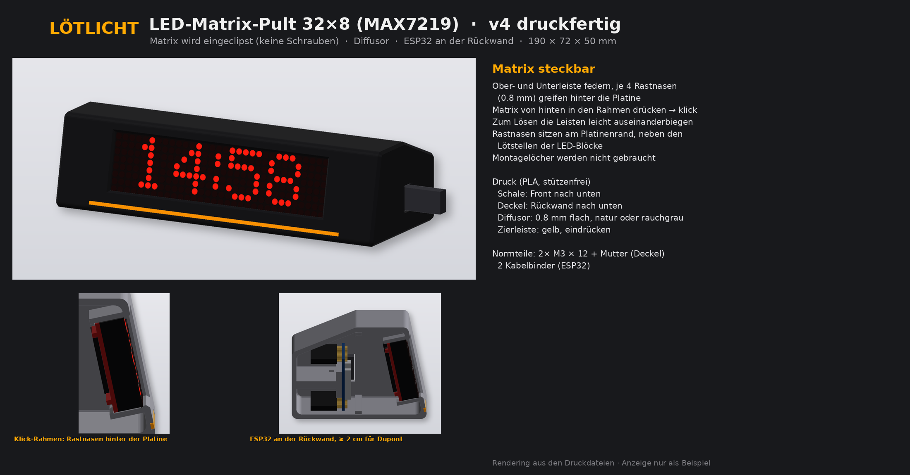
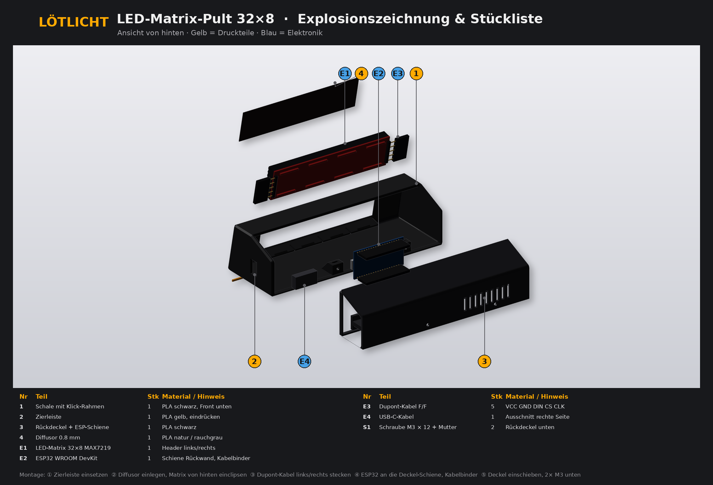
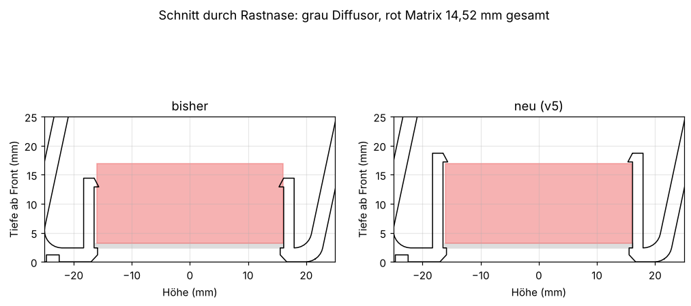

<h1 align="center">📟 TikTok-Matrix</h1>

  <b>LED-Matrix-Pult, das deine TikTok-Follower, die Uhrzeit und das Datum mit Kalenderwoche anzeigt.</b> 
  ESP32 · MAX7219 32×8 · Arduino · 3D-Druck – ein Projekt von <a href="https://github.com/Loetlicht">Lötlicht</a>

  
  
  
  

  

---

## Was sie anzeigt

Die Matrix wechselt im Kreis zwischen drei Anzeigen:

| # | Anzeige | Beispiel | Dauer |
|---|---|---|---|
| 1 | Uhrzeit mit blinkendem Doppelpunkt | `07:42` | 15 s |
| 2 | Datum mit Kalenderwoche als Lauftext | `Di 20.10.2026  KW 43` | einmal durch |
| 3 | TikTok-Follower mit Noten-Symbol | `♪ 1234` bzw. `♪ 12.3k` | 6 s |

- Die Uhrzeit kommt per NTP aus dem Internet, Sommer- und Winterzeit stellt sie selbst um.
- Die Kalenderwoche wird nach ISO 8601 berechnet, also so, wie sie in der Schweiz und in Deutschland gilt.
- Von 22 bis 7 Uhr wird die Matrix gedimmt.
- Die Follower-Zahl wird alle 10 Minuten abgefragt. Klappt das nicht, bleibt die letzte Zahl stehen.

---

## Teile

| Nr | Teil | Menge | Hinweis |
|---|---|---|---|
| 1 | Schale mit Klick-Rahmen | 1 | PLA schwarz, **v5** verwenden |
| 2 | Zierleiste | 1 | PLA gelb, in der AMS-Datei schon enthalten |
| 3 | Rückdeckel mit ESP-Schiene | 1 | PLA schwarz |
| 4 | Diffusor 0,8 mm, 132 × 32,4 mm | 1 | PLA natur oder rauchgrau |
| E1 | LED-Matrix 32×8, 4× MAX7219 (FC16) | 1 | mit Diffusor zusammen 14,5 mm dick |
| E2 | ESP32 WROOM DevKit | 1 | mit Stiftleisten |
| E3 | Dupont-Kabel Buchse/Buchse | 5 | VCC, GND, DIN, CS, CLK |
| E4 | USB-C-Kabel und 5-V-Netzteil | 1 | Kabel geht rechts hinten heraus |
| S1 | Linsenkopfschraube M3 × 12 mit Mutter | 2 | Rückdeckel unten |
| S2 | Kabelbinder | 2 | ESP32 an der Schiene |

Die Stückliste gibt es auch als [CSV](docs/stueckliste.csv).

---

## Drucken

Alle Dateien liegen in [`print/`](print/). Alles ist PLA und ohne Stützen druckbar.

| Datei | Farbe | Lage |
|---|---|---|
| `Matrix_Schale_mit_Zierleiste_AMS_v5.3mf` | schwarz + gelb (AMS) | Front nach unten |
| `Matrix_Schale_schwarz_Front-unten_v5.stl` | schwarz, ohne AMS | Front nach unten |
| `Matrix_Zierleiste_gelb.stl` | gelb | nur zur einfarbigen Schale, eindrücken |
| `Matrix_Rueckdeckel_schwarz.stl` | schwarz | Rückwand nach unten |
| `Matrix_Diffusor_0.8mm_132mm_v5.stl` | natur oder rauchgrau | flach, 132 × 32,4 mm |
| `Matrix_TESTDRUCK_Rastnasen_v5.stl` | beliebig | Front nach unten, zum Testen der Passung |

> **Tipp:** Druck zuerst den kleinen Testdruck. Leg den Diffusor ein und drück die Matrix gerade hinein. Wenn sie sauber einklickt, passt auch die ganze Schale.

**Seit v5** sitzen die Rastnasen 4,3 mm weiter hinten, damit Matrix und Diffusor (14,52 mm) Platz haben. Die Schale aus v4 ist dafür zu knapp.

---

## Zusammenbau

1. Diffusor von hinten ins Fenster der Schale legen.
2. Matrix gerade daraufdrücken, bis die Rastnasen oben und unten einklicken. Zum Lösen die Leisten leicht auseinanderbiegen.
3. Dupont-Kabel an der Eingangsseite der Matrix aufstecken.
4. ESP32 mit 2 Kabelbindern an die Schiene im Rückdeckel binden. Hinter den Stiftleisten bleiben gut 2 cm Platz für die Stecker.
5. Rückdeckel einsetzen und unten mit 2 × M3 × 12 verschrauben. USB-C-Kabel durch den Ausschnitt rechts hinten führen.

### Verdrahtung

| Matrix | ESP32 |
|---|---|
| VCC | 5V / VIN |
| GND | GND |
| DIN | GPIO 23 |
| CS | GPIO 5 |
| CLK | GPIO 18 |

---

## Firmware

Der Sketch liegt in [`firmware/matrix_tiktok/`](firmware/matrix_tiktok/). Eine Anleitung mit Bibliotheken, WLAN-Einrichtung und Fehlersuche steht in [`firmware/README.md`](firmware/README.md).

Kurz zusammengefasst:
1. In der Arduino IDE die Bibliothek **MD_Parola** installieren.
2. `secrets_example.h` in `secrets.h` umbenennen und dein WLAN eintragen.
3. In `matrix_tiktok.ino` bei `TIKTOK_USER` deinen TikTok-Namen eintragen.
4. Board **ESP32 Dev Module** wählen und hochladen.

> **Zur Follower-Zahl:** TikTok bietet dafür keine freie Schnittstelle. Der Sketch liest deshalb die öffentliche Profilseite. In manchen Netzen, zum Beispiel in Firmen-WLANs, schickt TikTok stattdessen ein Captcha. Dann bleibt die letzte Zahl stehen. Zuhause am Privatanschluss klappt es in der Regel.

---

## Ordner

| Ordner | Inhalt |
|---|---|
| [`print/`](print/) | Druckdateien (3MF für AMS und STL) |
| [`firmware/`](firmware/) | Arduino-Sketch und Anleitung |
| [`docs/`](docs/) | Bilder und Stückliste |

---

## Lizenz

Dieses Projekt steht unter der [Creative Commons Namensnennung – Nicht kommerziell – Weitergabe unter gleichen Bedingungen 4.0 International](https://creativecommons.org/licenses/by-nc-sa/4.0/deed.de) (CC BY-NC-SA 4.0). Du darfst es nachbauen, verändern und teilen, solange du Lötlicht nennst, es nicht kommerziell nutzt und Abwandlungen unter derselben Lizenz weitergibst. Den vollständigen Text findest du in [`LICENSE`](LICENSE).

TikTok ist eine Marke von ByteDance. Dieses Projekt steht in keiner Verbindung zu TikTok.

<i>Mehr Projekte auf TikTok: <a href="https://www.tiktok.com/@loetlicht">@loetlicht</a> 🔥</i>

